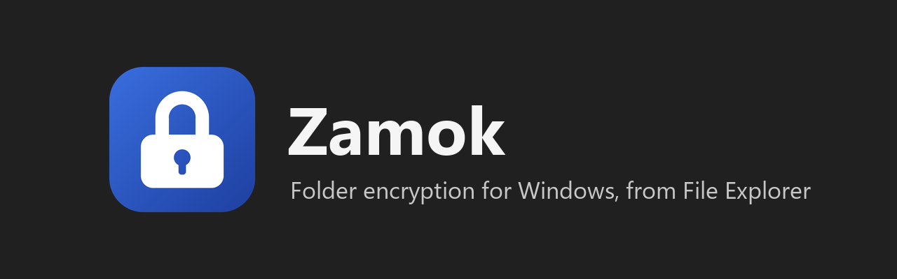
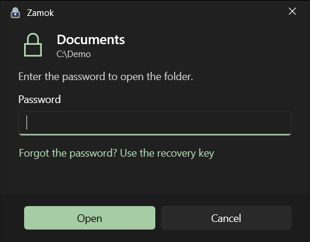
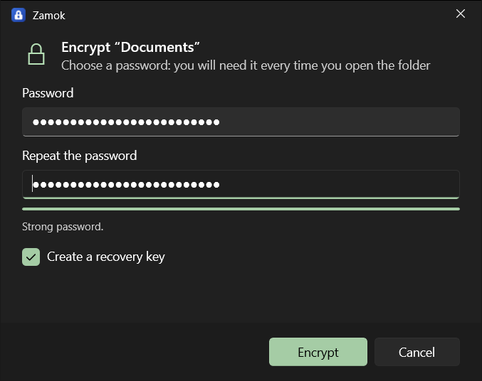
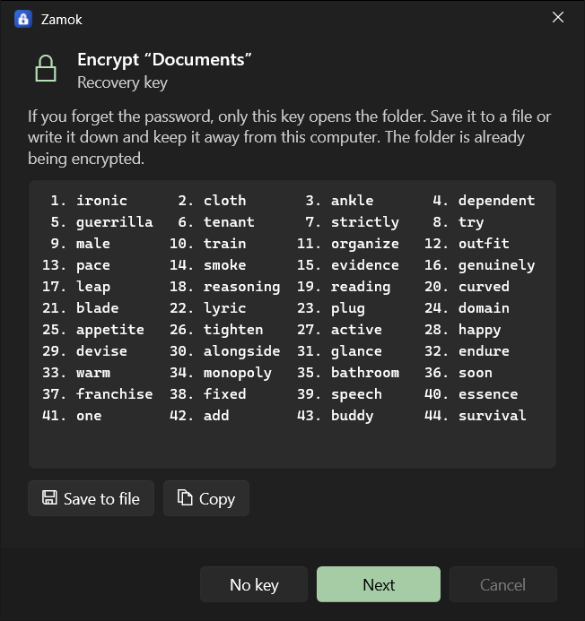
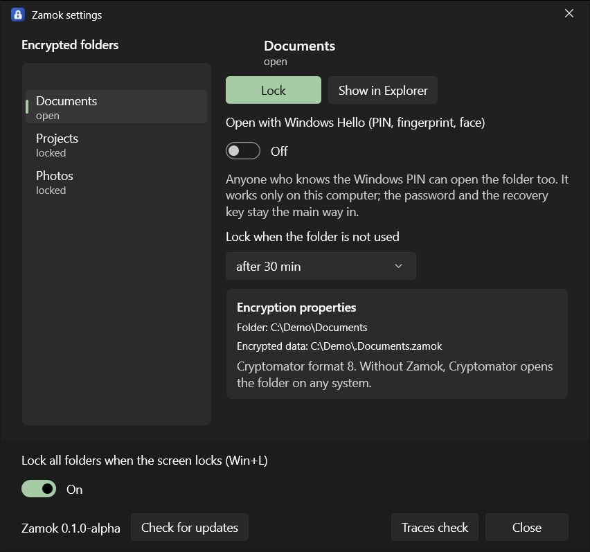

<p align="center">
  
</p>

<p align="center">
  <a href="https://github.com/olerast67/zamok/releases"></a>
  <a href="LICENSE"></a>
  
</p>

<p align="center"><b>English</b> / <a href="README.ru.md">Русский</a> / <a href="https://olerast67.github.io/zamok/">Website</a></p>

Zamok encrypts a folder on Windows 10 and 11 from File Explorer. Right-click a folder and choose "Encrypt with password". The folder stays at its path. To open it, double-click the lock icon inside, enter the password or use Windows Hello. When you lock the screen, the folder locks.

Zamok is free, open source under GPL-3.0, and it is an alpha. It has **not been audited by a third party**. Keep a backup of important data outside Zamok.

> [!WARNING]
> **Do not drag an open folder to another place with the mouse.** Explorer copies the files there unencrypted and deletes them from the vault. Lock the folder first: a locked folder has nothing to copy and stays where it is. Zamok cancels "Cut" on an encrypted folder and moving a parent folder to another drive. Windows offers no way to intercept dragging the folder itself. Other file managers do not see these checks.

## Screenshots

| Open a folder | Encrypt a folder |
|:---:|:---:|
|  |  |

| Recovery key | Settings |
|:---:|:---:|
|  |  |

The recovery key in the picture belongs to a test folder that no longer exists.

## How it works

When you encrypt a folder, Zamok writes an encrypted copy to a hidden folder next to it, `.Documents.zamok`, checks the copy and then deletes the original. If the program crashes at any step, your files stay intact. If it happens while copying, the files already verified are kept, and encrypting again with the same password continues where it stopped. After the copy is verified, Zamok finishes the work.

In place of the original, the WinFsp driver presents a virtual folder at the same path. Shortcuts, program projects and recent files keep their paths.

While the folder is locked, the virtual folder shows one icon that opens the password window. While it is open, files are decrypted on read and encrypted on write, and Zamok keeps the plaintext in memory.

The folder locks when you press Win+L, when the computer goes to sleep or hibernates, when you sign out, and after 30 minutes without work in it. The timeout is set per folder in Settings. If it is time to lock by timeout but files in the folder are open, Zamok asks whether to lock now or postpone for 10 minutes, and shows which program holds the files. Ctrl+Alt+Shift+L locks all folders at once.

File contents and file names are encrypted with the Cryptomator vault format 8 (AES-GCM, AES-SIV, scrypt), through the RustCrypto libraries. The name of the encrypted folder itself stays visible.

## What it protects against

It protects against:
- a stolen or lost laptop that is turned off;
- copies of the folder, USB drives, cloud storage;
- another user of the same computer (the check with a second account is still on the [roadmap](ROADMAP.md));
- someone who sits down at your computer while the folder is locked.

It does not protect against:
- malware on your computer while the folder is open;
- someone who knows the password or your Windows Hello PIN;
- deletion: an encrypted folder cannot be read, but it can be deleted.

## Traces in Windows

Zamok writes no decrypted data to disk itself. Windows and other programs leave traces:

| Where | What happens |
|---|---|
| Windows Search index | Files are marked "do not index" |
| Thumbnail cache | Explorer stores small copies of pictures and videos in `thumbcache_*.db` on the system drive, and they stay there after the folder is locked (checked, [research 05](docs/research/05-thumbnail-cache.md), in Russian). Windows cannot turn this off for a single folder, and Zamok has no safe way to do it from the file system. If it matters to you: File Explorer Options, View tab, "Always show icons, never thumbnails", then remove "Thumbnails" in Disk Cleanup. This turns thumbnails off in every folder |
| Recent files | Shortcuts to the folder's files are removed on lock; taskbar jump lists stay for now |
| Autosave and temporary files | Word, Photoshop and others write them to their own folders outside Zamok |
| Page file and hibernation file | Contents of open files may end up there. Zamok keeps its keys in memory that Windows does not page out, and before sleep and hibernation the folders lock and the keys are wiped |
| Recycle Bin | There is none: a file deleted from an open folder is gone at once |

Encrypting the system drive (BitLocker or Device Encryption) covers almost all of these traces if the laptop is stolen. "Traces check" in Zamok settings shows whether the system drive is encrypted, whether hibernation is on, whether the page file is encrypted, whether your folders are in the search index and whether Explorer makes thumbnails. It only looks and changes nothing.

## Install

Download `Zamok-Setup-<version>.exe` from [Releases](https://github.com/olerast67/zamok/releases). The setup program contains the WinFsp driver and installs it only if WinFsp is absent. Windows asks for administrator rights for the driver. Zamok itself installs for your user account into `%LOCALAPPDATA%\Programs\Zamok`.

The installer is not signed yet, because a code signing certificate is still ahead on the [roadmap](ROADMAP.md). SmartScreen shows "Windows protected your PC". Check the SHA-256 listed on the release page, then choose **More info** and **Run anyway**:

```powershell
Get-FileHash .\Zamok-Setup-0.1.0.exe -Algorithm SHA256
```

Smart App Control on Windows 11 blocks unsigned programs, so Zamok cannot be installed while it is turned on.

On Windows 11 the Zamok items are under "Show more options" in the right-click menu, because the short menu accepts only signed packages.

Requirements: Windows 10 or 11, x64, a folder on an NTFS drive. USB sticks with exFAT or FAT32 are not supported yet. Zamok refuses folders inside OneDrive, Dropbox and Yandex Disk until cloud clients are tested with an open folder. Development and testing so far were on Windows 10; the Windows 11 run in a virtual machine is on the roadmap.

## Recovery without Zamok

An encrypted folder is a standard Cryptomator vault. If Zamok stops working or you uninstall it, the data stays in the hidden `.Name.zamok` folder. Turn on hidden and protected system files in Explorer to see it. Uninstalling leaves a `HOW TO OPEN Name.txt` note next to it.

1. Install [Cryptomator](https://cryptomator.org) on Windows, macOS, Linux, iOS or Android.
2. Open `vault.cryptomator` from the hidden folder.
3. Enter your password. If you forgot it, Cryptomator resets the password with the 44-word recovery key from Zamok.

Compatibility is tested in both directions against vaults made by Cryptomator 1.19.6. The repository also has `zamok-recover`, a command-line tool that exports a decrypted copy with the password or the recovery key. Build it from `core/`.

Without the password and without the recovery key, the data cannot be recovered. The recovery key is optional in the wizard and on by default.

## Compared with VeraCrypt and Cryptomator

| | Zamok | VeraCrypt | Cryptomator |
|---|---|---|---|
| Where you work with files | The folder at its own path | A container or partition mounted as a drive | A vault mounted as a virtual drive |
| Container size | Grows with the files | Fixed for file containers (dynamic containers exist) | Grows with the files |
| Encrypts the system drive | No | Yes | No |
| Hidden volumes | No | Yes | No |
| Platforms | Windows | Windows, macOS, Linux | Windows, macOS, Linux, iOS, Android |
| Folders in cloud sync | Refused for now | A container syncs as one file | Made for this case |
| Independent audit | **None** | Yes, of earlier versions | Yes, of earlier versions |
| Maturity | Alpha | Years of releases | Years of releases |

If you need an audited tool today, use VeraCrypt or Cryptomator. Zamok is written for one case: a folder that stays where it is and opens from Explorer. Speed measurements are in [bench/RESULTS.md](bench/RESULTS.md): large files copy and read at more than half the speed of NTFS, file listing and `git status` are 3-4 times slower than NTFS.

## Privacy

Zamok has no telemetry, no accounts and no servers. The only network request is the "Check for updates" button in the settings: one request to GitHub with the program version in it, sent only when you press the button. Details in [PRIVACY.md](PRIVACY.md).

## Status

Version 0.1.0-alpha. Open items that matter for your data, all from the [roadmap](ROADMAP.md): no third-party review, no fuzzing of format parsing yet, power-loss tests on a virtual machine not done, Windows 11 and cloud clients not tested. Updates are checked only with the button in the settings, and nothing is installed automatically: you download the new version yourself and install it over the old one, which keeps your folder list.

## Documents

- [PRIVACY.md](PRIVACY.md), what the programs store and send
- [SECURITY.md](SECURITY.md), how to report a vulnerability privately
- [CONTRIBUTING.md](CONTRIBUTING.md), building and tests
- [CHANGELOG.md](CHANGELOG.md), [RELEASING.md](RELEASING.md)
- [THIRD_PARTY_NOTICES.md](THIRD_PARTY_NOTICES.md), components and licenses
- [ROADMAP.md](ROADMAP.md), [docs/DESIGN.md](docs/DESIGN.md), [docs/STACK.md](docs/STACK.md) and [docs/research](docs/research/), in Russian

## Code signing policy

Zamok has applied to SignPath Foundation for free code signing. Once the application is approved, release files are signed under this policy: free code signing provided by [SignPath.io](https://about.signpath.io), certificate by [SignPath Foundation](https://signpath.org).

- Committers and reviewers: [olerast67](https://github.com/olerast67)
- Approvers: [olerast67](https://github.com/olerast67)
- Every release is built by GitHub Actions from a tag in this repository (`.github/workflows/release.yml`) and approved by hand before signing.

Privacy: this program will not transfer any information to other networked systems unless specifically requested by the user or the person installing or operating it. The only such request is the "Check for updates" button, see [PRIVACY.md](PRIVACY.md).

## License

GPL-3.0, see [LICENSE](LICENSE), with an additional permission for the Windows App SDK: [LICENSE-EXCEPTION.md](LICENSE-EXCEPTION.md).

**How this was made:** the author designed the app, directed the work and checked it on a real computer. Much of the code was written with an AI coding assistant (Claude by Anthropic). It has not been audited by a third party.

Zamok uses WinFsp: WinFsp - Windows File System Proxy, Copyright (C) Bill Zissimopoulos, https://github.com/winfsp/winfsp
