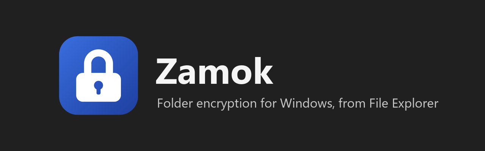
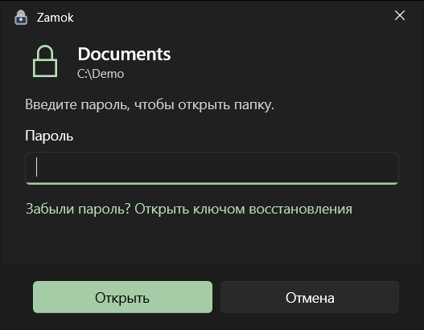
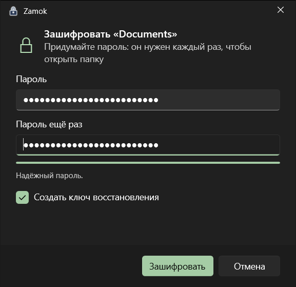
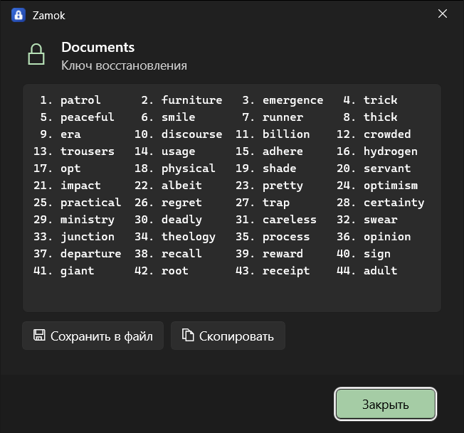
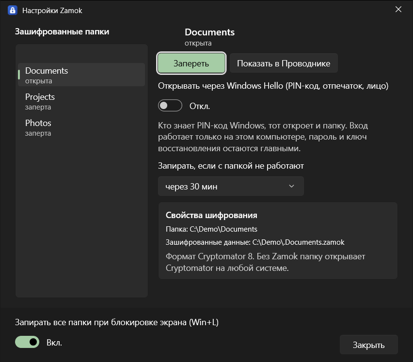

<p align="center">
  
</p>

<p align="center">
  <a href="https://github.com/olerast67/zamok/releases"></a>
  <a href="LICENSE"></a>
  
</p>

<p align="center"><a href="README.md">English</a> / <b>Русский</b> / <a href="https://olerast67.github.io/zamok/ru/">Сайт</a></p>

Zamok шифрует папки в Windows 10 и 11 прямо из Проводника. Правый клик по папке, «Зашифровать паролем». Папка остаётся на своём пути. Чтобы открыть её, дважды щёлкните значок замка внутри и введите пароль или подтвердите вход через Windows Hello. Заблокировали экран, и папка снова заперта.

Zamok бесплатный, с открытым кодом под GPL-3.0, сейчас это альфа-версия. Сторонний аудит **не проводился**. Держите копию важных данных вне Zamok.

> [!WARNING]
> **Не перетаскивайте открытую папку мышкой в другое место.** Проводник скопирует файлы туда без шифрования и удалит их из хранилища. Сначала заприте папку: у запертой копировать нечего, и она останется на месте. Zamok сам отменяет «Вырезать» на зашифрованной папке и перенос родительской папки на другой диск. Перетаскивание самой папки Windows перехватить не даёт. Другие файловые менеджеры эти запреты не видят.

## Как это выглядит

<p></p>

| Открыть папку | Зашифровать папку |
|:---:|:---:|
|  |  |

| Ключ восстановления | Настройки |
|:---:|:---:|
|  |  |

Ключ на картинке относится к тестовой папке, её уже нет.

## Как это устроено

Когда вы шифруете папку, Zamok записывает зашифрованную копию в скрытую папку рядом, `.Documents.zamok`, проверяет копию и только потом удаляет оригинал. При аварийном завершении программы на любом шаге файлы остаются целы: до проверки копии Zamok откатывает работу, после проверки доводит её до конца.

На месте оригинала драйвер WinFsp показывает виртуальную папку с тем же путём. Ярлыки, проекты в программах и «Недавние файлы» продолжают работать.

Пока папка заперта, внутри виден один значок, который открывает окно пароля. Пока открыта, файлы расшифровываются при чтении и шифруются при записи, а открытый текст Zamok держит в памяти.

Папка запирается по Win+L, при сне и гибернации, при выходе из системы и через 30 минут без работы с ней. Время настраивается для каждой папки. Ctrl+Alt+Shift+L запирает все папки сразу.

Содержимое и имена файлов шифруются в формате Cryptomator vault format 8 (AES-GCM, AES-SIV, scrypt) библиотеками RustCrypto. Имя самой зашифрованной папки остаётся видимым.

## От чего защищает

Защищает:
- украденный или потерянный выключенный ноутбук;
- копию папки, флешку, облако;
- другого пользователя этого компьютера (проверка вторым пользователем ещё впереди, см. [дорожную карту](ROADMAP.md));
- человека, который сел за ваш компьютер, пока папка заперта.

Не защищает:
- от вируса на вашем компьютере, пока папка открыта;
- от человека, который знает пароль или PIN-код Windows Hello;
- от удаления: зашифрованную папку нельзя прочитать, но можно удалить.

## Следы в Windows

Сам Zamok расшифрованное на диск не пишет, но Windows и программы оставляют следы:

| Где | Что происходит |
|---|---|
| Индекс поиска Windows | Файлы отдаются с пометкой «не индексировать» |
| Кэш миниатюр | Проводник может сохранить уменьшенные копии картинок на системном диске, отключить это для одной папки нельзя |
| «Недавние файлы» | Ярлыки на файлы папки удаляются при запирании; списки в панели задач пока остаются |
| Автосохранение и временные файлы программ | Word, Photoshop и другие пишут их в свои папки вне Zamok |
| Файл подкачки и файл гибернации | В них может попасть содержимое памяти, включая ключи: запрет выгрузки ключей пока не сделан |
| Корзина | Её нет: файл из открытой папки удаляется сразу |

Почти все эти следы при краже ноутбука закрывает шифрование системного диска (BitLocker или «Шифрование устройства»).

## Установка

Скачайте `Zamok-Setup-<версия>.exe` со страницы [Releases](https://github.com/olerast67/zamok/releases). Внутри лежит драйвер WinFsp, он ставится, только если его ещё нет, и ради него Windows спросит права администратора. Сам Zamok ставится для вашего пользователя в `%LOCALAPPDATA%\Programs\Zamok`.

Установщик пока без подписи: сертификат ещё впереди по [дорожной карте](ROADMAP.md). SmartScreen покажет «Система Windows защитила ваш компьютер». Сверьте SHA-256 со страницей релиза, потом нажмите **Подробнее** и **Выполнить в любом случае**:

```powershell
Get-FileHash .\Zamok-Setup-0.1.0.exe -Algorithm SHA256
```

Интеллектуальное управление приложениями в Windows 11 блокирует неподписанные программы, поэтому при включённой защите Zamok не поставить.

В Windows 11 пункты Zamok лежат в «Показать дополнительные параметры» меню правой кнопки: в короткое меню Windows пускает только подписанные пакеты.

Что нужно: Windows 10 или 11, x64, папка на диске NTFS. Флешки с exFAT и FAT32 пока не поддерживаются. Папки внутри OneDrive, Dropbox и Яндекс.Диска Zamok не шифрует, пока работа облаков с открытой папкой не проверена. Разработка и проверки пока шли на Windows 10, прогон на Windows 11 в виртуальной машине есть в дорожной карте.

## Как открыть без Zamok

Зашифрованная папка это обычное хранилище Cryptomator. Если Zamok перестанет работать или вы его удалите, данные останутся в скрытой папке `.Имя.zamok`. Чтобы её увидеть, включите в Проводнике показ скрытых и системных файлов. При удалении программы рядом появляется файл `КАК ОТКРЫТЬ Имя.txt`.

1. Установите [Cryptomator](https://cryptomator.org) на Windows, macOS, Linux, iOS или Android.
2. Откройте файл `vault.cryptomator` из скрытой папки.
3. Введите пароль. Если забыли, Cryptomator сбросит его по ключу восстановления из 44 слов, который выдал Zamok.

Совместимость проверена в обе стороны на хранилищах Cryptomator 1.19.6. В репозитории есть и `zamok-recover`, программа для командной строки: выгружает расшифрованную копию по паролю или ключу восстановления. Собирается из `core/`.

Без пароля и ключа восстановления данные вернуть нельзя. Ключ в мастере необязателен и включён по умолчанию.

## Сравнение с VeraCrypt и Cryptomator

| | Zamok | VeraCrypt | Cryptomator |
|---|---|---|---|
| Где лежат файлы при работе | В папке на её пути | В контейнере или разделе, подключённом как диск | В хранилище, подключённом как виртуальный диск |
| Размер контейнера | Растёт вместе с файлами | Задаётся заранее (есть динамические контейнеры) | Растёт вместе с файлами |
| Шифрование системного диска | Нет | Есть | Нет |
| Скрытые тома | Нет | Есть | Нет |
| Системы | Windows | Windows, macOS, Linux | Windows, macOS, Linux, iOS, Android |
| Папки в облаке | Пока отказывает | Контейнер синхронизируется одним файлом | Сделан для этого |
| Независимый аудит | **Нет** | Был, для прошлых версий | Был, для прошлых версий |
| Зрелость | Альфа | Много лет релизов | Много лет релизов |

Если проверенный инструмент нужен сегодня, берите VeraCrypt или Cryptomator. Zamok сделан для одного случая: папка остаётся на месте и открывается из Проводника. Замеров скорости с шифрованием он пока не публикует, цели и замеры без шифрования есть в [DESIGN.md](docs/DESIGN.md), раздел 7.

## Конфиденциальность

В Zamok нет телеметрии, аккаунтов и серверов, программы не обращаются к сети. Подробности в [PRIVACY.md](PRIVACY.md).

## Состояние проекта

Версия 0.1.0-alpha. Что не сделано и важно для ваших данных, по [дорожной карте](ROADMAP.md): нет проверки посторонним человеком, нет fuzzing разбора формата, тестов с отключением питания не было, Windows 11 и облачные клиенты не проверены. Проверки обновлений нет: новая версия ставится поверх старой и сохраняет список папок.

## Документы

- [PRIVACY.md](PRIVACY.md): что программы хранят и отправляют
- [SECURITY.md](SECURITY.md): как сообщить об уязвимости
- [CONTRIBUTING.md](CONTRIBUTING.md): сборка и проверки
- [CHANGELOG.md](CHANGELOG.md), [RELEASING.md](RELEASING.md)
- [THIRD_PARTY_NOTICES.md](THIRD_PARTY_NOTICES.md): компоненты и лицензии
- [ROADMAP.md](ROADMAP.md), [docs/DESIGN.md](docs/DESIGN.md), [docs/STACK.md](docs/STACK.md), [docs/research](docs/research/)

## Лицензия

GPL-3.0, текст в [LICENSE](LICENSE), с дополнительным разрешением для Windows App SDK: [LICENSE-EXCEPTION.md](LICENSE-EXCEPTION.md).

**Как это сделано:** автор придумал программу, руководил работой и проверял её на настоящем компьютере. Большую часть кода написал ИИ-ассистент (Claude от Anthropic). Независимого аудита не было.

Zamok использует WinFsp: WinFsp - Windows File System Proxy, Copyright (C) Bill Zissimopoulos, https://github.com/winfsp/winfsp
